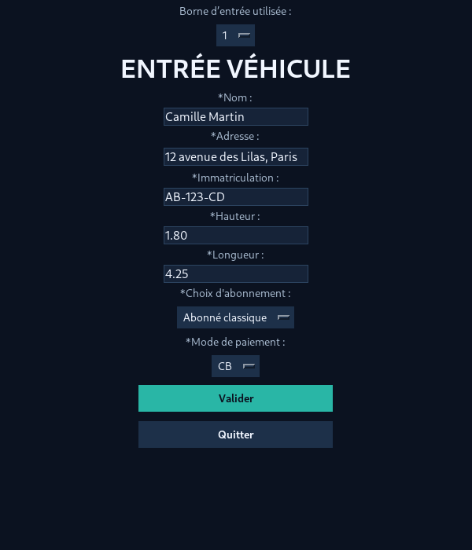
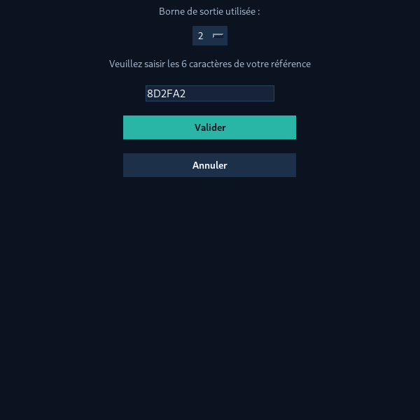
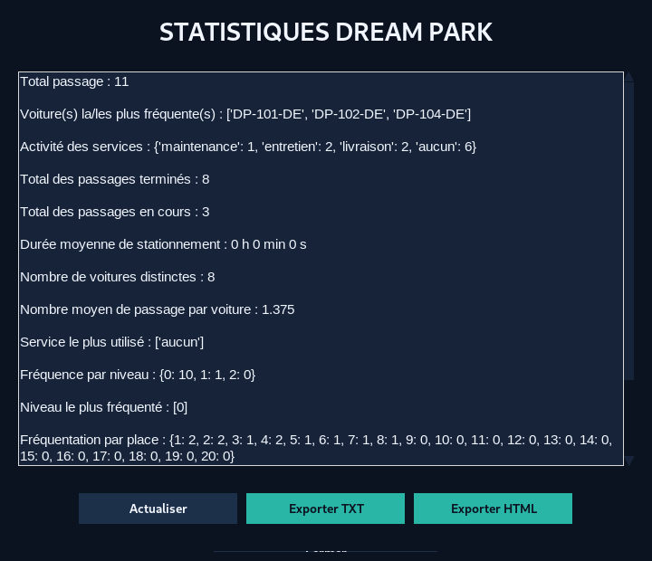

<div align="center">

# 🚗 Dream Park
### Application de gestion et de simulation d’un parking intelligent

**Projet universitaire · Python · Programmation orientée objet · Architecture MVC**


Application de bureau qui simule la gestion d’un parking : **stationnement, entrées et sorties, abonnements, services, livraisons, statistiques et sauvegarde persistante**.

**20 places · 3 niveaux · 2 accès indépendants simulés · 205 tests validés**

[📸 Voir les captures](#-aperçu-de-lapplication) · [✨ Fonctionnalités](#-fonctionnalités) · [🚀 Installation](#-installation-et-exécution) · [🧪 Tests](#-tests-et-validation)

</div>

---

## 📸 Aperçu de l’application

### Tableau de bord et identification

<table>
  <tr>
    <th align="center">Tableau de bord</th>
    <th align="center">Identification et choix de l’espace</th>
  </tr>
  <tr>
    <td align="center"></td>
    <td align="center"></td>
  </tr>
</table>

### Gestion des véhicules et statistiques

<table>
  <tr>
    <th align="center">Entrée d’un véhicule</th>
    <th align="center">Sortie d’un véhicule</th>
  </tr>
  <tr>
    <td align="center"></td>
    <td align="center"></td>
  </tr>
</table>

<div align="center">
  <strong>Tableau des statistiques</strong><br><br>
  
</div>

> **Design :** interface Tkinter harmonisée autour d’un thème bleu nuit et turquoise. Les captures utilisent des données de démonstration et ne contiennent pas de données clients réelles.

---

## 🎯 Présentation du projet

**Dream Park** est un projet développé dans le cadre de la **Licence 3 MIASHS — parcours Informatique et SHS**, à l’**Université Toulouse – Jean-Jaurès**.

L’objectif est de concevoir une simulation de parking à partir d’une **architecture Modèle–Vue–Contrôleur (MVC)**. L’application organise le parcours des véhicules, les opérations des clients et les fonctions réservées aux espaces Voiturier et Administrateur.

Les caméras, bornes, panneaux et téléporteurs sont des **équipements simulés en Python**. Le projet fonctionne localement sans serveur ni matériel connecté.

## ✨ Fonctionnalités

| Module | Fonctionnalités |
|:--|:--|
| 🚗 **Parking** | 20 places réparties sur 3 niveaux ; suivi de l’occupation et de la disponibilité |
| 📐 **Attribution des places** | Recherche d’une place adaptée à la hauteur et à la longueur d’un véhicule |
| 🚧 **Deux accès** | Deux bornes simulées distinctes, utilisant un parking et un compteur de places communs |
| 🎫 **Tickets** | Génération d’une référence hexadécimale de 6 caractères pour la sortie |
| 👤 **Clients** | Session nouveau client et identification par numéro de carte à 8 chiffres |
| 💳 **Abonnements** | Abonnement classique, Super-abonné, changement de formule et résiliation |
| 🧰 **Services** | Maintenance, entretien et demande de livraison |
| 🧑‍✈️ **Voiturier** | Affichage des demandes de livraison et confirmation de leur exécution |
| 📊 **Administrateur** | Statistiques de fréquentation, suivi des services et exports TXT/HTML |
| 💾 **Sauvegarde** | Conservation locale des clients, véhicules, emplacements et historiques dans un fichier JSON |

### Deux accès, un parking partagé

```text
                    DREAM PARK
           ┌────────────────────────┐
           │     PARKING COMMUN     │
           │ 20 places / 3 niveaux  │
           └───────────┬────────────┘
                       │
              ┌────────┴────────┐
              │                 │
        ┌─────┴─────┐     ┌─────┴─────┐
        │  ACCÈS 1  │     │  ACCÈS 2  │
        │  Caméra   │     │  Caméra   │
        │  Ticket   │     │  Ticket   │
        │  Panneau  │     │  Panneau  │
        └───────────┘     └───────────┘
```

Une voiture peut entrer par l’accès 1 et ressortir par l’accès 2 avec la même référence de ticket. Chaque accès simule ses propres équipements ; l’état du parking est commun aux deux.

## 🧭 Parcours utilisateur

1. **Identification** — le client renseigne sa carte ou démarre une nouvelle session ; les espaces Voiturier et Administrateur sont également proposés.
2. **Entrée** — sélection d’un accès, saisie de l’immatriculation et des dimensions, affectation d’une place compatible et création d’un ticket.
3. **Gestion des services** — un client abonné peut demander une maintenance, un entretien ou une livraison avec une heure souhaitée.
4. **Livraison** — le voiturier consulte les livraisons en attente et confirme l’exécution de la demande.
5. **Sortie** — saisie des 6 caractères de référence à une borne ; la place redevient disponible.
6. **Statistiques** — l’administrateur consulte les données du parking et peut les exporter aux formats TXT ou HTML.

## 🛠️ Stack technique

| Technologie | Rôle |
|:--|:--|
| **Python 3** | Logique métier et programmation orientée objet |
| **Tkinter** | Fenêtres et composants de l’interface graphique |
| **MVC** | Séparation entre les données, l’interface et les commandes |
| **JSON** | Persistance de l’état du parking |
| **unittest** | Tests unitaires et tests d’intégration |
| **unittest.mock** | Simulation des fenêtres et dépendances lors des tests |
| **Git / GitHub** | Versionnement et partage du projet |

**Dépendances :** uniquement la bibliothèque standard Python, avec Tkinter disponible sur la machine.

## 🏗️ Architecture MVC

```text
DreamPark/
├── Class/                      # Modèles et règles métier
│   ├── main.py                 # Point d’entrée de l’application
│   ├── acces.py                # Gestion des deux accès
│   ├── parking.py              # Places et occupation
│   ├── place.py
│   ├── placement.py
│   ├── voiture.py
│   ├── client.py
│   ├── abonnement.py
│   ├── voiturier.py
│   ├── administrateur.py
│   ├── statistique.py
│   ├── sauvegarde.py
│   └── ...
├── Controleur/
│   └── controleur_principal.py # Liaison vues / logique métier
├── Vue/                        # Fenêtres Tkinter
│   ├── vue_principale.py
│   ├── vue_identification.py
│   ├── vue_entree.py
│   ├── vue_sortie.py
│   ├── vue_voiturier.py
│   ├── vue_administrateur.py
│   └── ...
├── Tests/                      # Suite de tests automatisés
│   ├── test_deux_acces.py
│   ├── test_sauvegarde.py
│   └── test_*.py
├── docs/
│   ├── screenshots/           # Captures utilisées par ce README
│   ├── RAPPORT_TESTS.md        # À placer ici si disponible
│   └── RAPPORT_TESTS.pdf       # À placer ici si disponible
├── .gitignore
└── README.md
```

### Répartition des responsabilités

- **Modèle (`Class/`)** : état du parking, règles d’attribution, tickets, abonnements, services et sauvegarde.
- **Vue (`Vue/`)** : affichage et saisie avec Tkinter.
- **Contrôleur (`Controleur/`)** : réception des actions, appels au modèle et mise à jour des vues.
- **Tests (`Tests/`)** : vérification des comportements isolés et des interactions entre composants.

## 🚀 Installation et exécution

### 1. Prérequis

- Python 3 installé sur Windows, macOS ou Linux.
- Tkinter fonctionnel et environnement disposant d’un affichage graphique.

### 2. Cloner le projet

```bash
git clone https://github.com/Caze1127/DreamPark-Parking-Management-System.git
cd DreamPark-Parking-Management-System
```

### 3. Démarrer Dream Park

```bash
python -m Class.main
```

Sous Windows, selon l’installation :

```powershell
py -m Class.main
```

> **Important :** lance la commande depuis la racine du dépôt. Évite `python Class/main.py`, car le projet utilise des imports relatifs.

## 🧪 Tests et validation

La dernière **campagne de tests documentée (9 novembre 2026)** indique :

<div align="center">

| ✅ Tests réussis | 📁 Fichiers de tests | ❌ Erreurs |
|:--:|:--:|:--:|
| **205** | **21** | **0** |

</div>

Pour lancer tous les tests :

```bash
python -m unittest discover -s Tests -p "test_*.py" -v
```

Pour vérifier des fonctionnalités précises :

```bash
python -m unittest Tests.test_deux_acces -v
python -m unittest Tests.test_sauvegarde -v
python -m unittest Tests.test_voiturier -v
```

Les tests couvrent notamment l’entrée et la sortie, les tickets, les abonnements, les services, la prise en charge garantie, les deux accès, la persistance JSON et les interfaces professionnelles.

📄 **Rapports de validation :** [version Markdown](docs/RAPPORT_TESTS.md) · [version PDF](docs/RAPPORT_TESTS.pdf). *Ces liens nécessitent d’ajouter les rapports dans `docs/`.*

> Le nombre de tests correspond à la dernière campagne documentée ; ce badge n’est pas une mesure de CI actualisée automatiquement.

## 🔒 Données et confidentialité

Le programme crée localement un fichier `donnees/dreampark.json` susceptible de contenir des noms, adresses, numéros de carte et immatriculations. **Ne publie pas ce fichier sur GitHub.**

Le fichier `.gitignore` doit notamment exclure :

```gitignore
donnees/*.json
__pycache__/
*.pyc
.venv/
.idea/
```

Les captures de ce README sont réalisées avec des données fictives.

## ⚠️ Limites du projet

- Les caméras, bornes et téléporteurs sont **simulés**, sans matériel physique.
- Les paiements sont fictifs et aucune transaction bancaire réelle n’est effectuée.
- Les espaces Voiturier et Administrateur ne disposent pas d’une authentification sécurisée de production.
- Les livraisons sont confirmées manuellement ; elles ne se déclenchent pas automatiquement à l’heure enregistrée.
- Le stockage est un fichier JSON local : l’application ne fournit pas de serveur partagé ou de gestion multi-utilisateur simultanée.

## 🌱 Pistes d’amélioration

Authentification et permissions des rôles, interface encore plus responsive, stockage en base de données, indicateurs visuels avancés et tests d’interface automatisés.

---

<div align="center">

**🚗 Dream Park — Projet universitaire Python / Tkinter**

<sub>Licence 3 MIASHS, parcours Informatique et SHS · Université Toulouse – Jean-Jaurès</sub>

</div>
