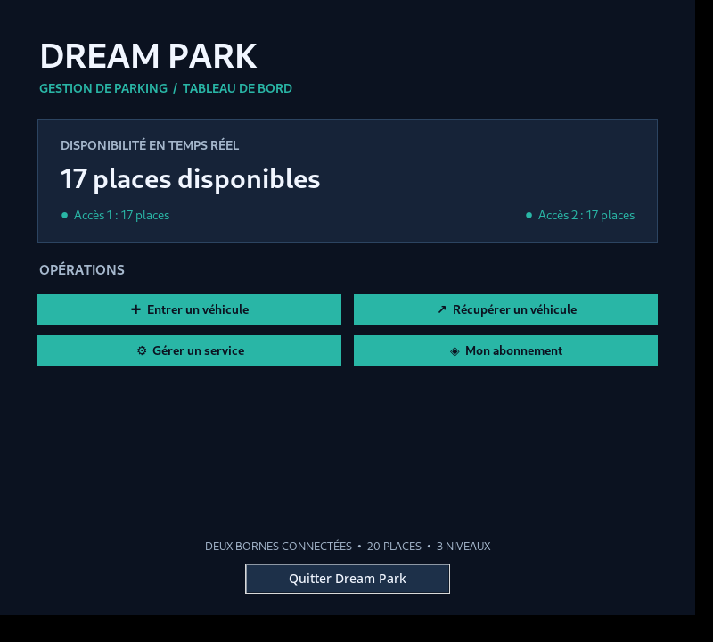
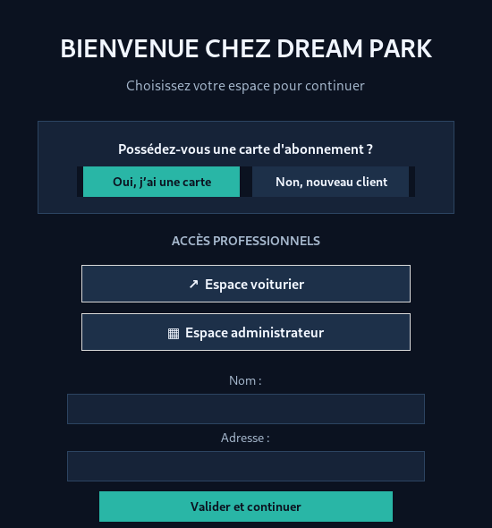

<div align="center">

# 🚗 Dream Park
### Application de gestion et de simulation d'un parking

**Projet universitaire Python · Programmation orientée objet · Architecture MVC**


Une application de bureau qui **simule le fonctionnement d'un parking** : entrées et sorties, attribution des places, abonnements, services, espaces professionnels, statistiques et sauvegarde locale.

**20 places · 3 niveaux · 2 accès simulés · 205 tests réussis lors de la campagne documentée**

[Découvrir les fonctionnalités](#fonctionnalités) · [Installer et lancer](#installation-et-démarrage) · [Consulter le rapport de tests](docs/RAPPORT_TESTS.md)

</div>

---

## Aperçu de l'application

<table>
  <tr>
    <td align="center"><strong>Tableau de bord</strong></td>
    <td align="center"><strong>Identification et choix d'espace</strong></td>
  </tr>
  <tr>
    <td></td>
    <td></td>
  </tr>
</table>

L'interface Tkinter utilise un thème bleu nuit et turquoise. Elle distingue les parcours **Client**, **Voiturier** et **Administrateur**. Les captures montrent des données de démonstration.

## Présentation du projet

Dream Park a été développé dans le cadre de la **Licence 3 MIASHS, parcours Informatique et SHS**, à l'**Université Toulouse – Jean-Jaurès**. L'objectif est de modéliser un système de gestion de parking en séparant les **règles métier**, les **actions utilisateur** et l'**interface graphique**.

Le système repose sur des objets Python représentant notamment le parking, ses places, ses accès, les véhicules, les clients et les abonnements. Les équipements tels que les caméras et les bornes sont **simulés** : aucune connexion à un dispositif physique n'est nécessaire.

## Fonctionnalités

| Domaine | Fonctionnalités principales |
|---|---|
| **Parking** | 20 places sur 3 niveaux ; choix d'une place selon les dimensions du véhicule ; suivi des disponibilités |
| **Accès** | Deux accès simulés avec caméras, bornes à tickets, panneaux et téléporteurs ; entrée par un accès et sortie par l'autre |
| **Tickets** | Référence hexadécimale de 6 caractères, utilisée pour récupérer le véhicule |
| **Clients** | Identification par carte à 8 chiffres ou création d'une session nouveau client |
| **Abonnements** | Formules classique et Super-abonné, changement de formule et résiliation |
| **Services** | Maintenance, entretien, demande de livraison et traitement depuis l'espace Voiturier |
| **Administration** | Consultation de statistiques et export des résultats aux formats TXT et HTML |
| **Sauvegarde** | Persistance locale au format JSON et rechargement des informations au redémarrage |

### Ce qui distingue le projet

- **Gestion cohérente de deux accès** partageant le même parking et le même nombre de places disponibles.
- **Vérification de compatibilité** entre les dimensions du véhicule et celles des places.
- **Parcours différenciés** pour les clients, les voituriers et l'administrateur.
- **Sauvegarde avec écriture temporaire**, puis remplacement du fichier JSON pour limiter les écritures incomplètes.
- **Couverture de plusieurs scénarios métier** par une suite automatisée de tests unitaires et d'intégration.

## Technologies

| Technologie | Utilisation |
|---|---|
| **Python 3** | Logique métier et programmation orientée objet |
| **Tkinter** | Interface graphique de bureau |
| **unittest / unittest.mock** | Tests automatisés et simulation de composants |
| **JSON / pathlib / os** | Sauvegarde et gestion des chemins de fichiers |
| **Git / GitHub** | Versionnement et publication du code |

Le projet utilise la bibliothèque standard de Python ; aucune bibliothèque Python externe n'est requise. Une installation de Python disposant de Tkinter est nécessaire.

## Architecture MVC

| Composant | Dossier | Rôle |
|---|---|---|
| **Modèle** | `Class/` | Objets métier, règles de gestion, statistiques, sauvegarde |
| **Vue** | `Vue/` | Fenêtres et interactions graphiques Tkinter |
| **Contrôleur** | `Controleur/` | Coordination entre actions de l'interface et logique métier |
| **Tests** | `Tests/` | Tests unitaires, d'intégration et scénarios de validation |
| **Documentation** | `docs/` | Rapport de tests et captures d'écran |

```text
DreamPark/
├── Class/
│   ├── main.py
│   ├── parking.py
│   ├── place.py
│   ├── acces.py
│   ├── client.py
│   ├── abonnement.py
│   ├── sauvegarde.py
│   └── ...
├── Controleur/
│   └── controleur_principal.py
├── Vue/
│   ├── vue_principale.py
│   ├── vue_identification.py
│   ├── vue_voiturier.py
│   ├── vue_administrateur.py
│   └── ...
├── Tests/
│   └── test_*.py
├── docs/
│   ├── RAPPORT_TESTS.md
│   ├── RAPPORT_TESTS.pdf
│   └── screenshots/
│       ├── tableau-de-bord.png
│       └── identification.png
└── README.md
```

Le dossier `donnees/` et son fichier `dreampark.json` sont **créés localement lorsque l'application sauvegarde son état** : ils ne doivent pas être publiés dans le dépôt.

## Installation et démarrage

**Prérequis :** Python 3 avec Tkinter installé. L'application est prévue pour une utilisation sur ordinateur avec interface graphique.

1. Cloner le dépôt :

   ```bash
   git clone https://github.com/Caze1127/DreamPark-Parking-Management-System.git
   ```

2. Ouvrir un terminal à la racine du projet :

   ```bash
   cd DreamPark-Parking-Management-System
   ```

3. Lancer l'application :

   ```bash
   python -m Class.main
   ```

Sous Windows, si la commande `python` n'est pas reconnue, essayer `py -m Class.main`.

> **Important :** ne pas lancer directement `python Class/main.py` : le projet utilise des imports de modules depuis le package `Class`.

## Exemple de parcours utilisateur

**Entrer un véhicule :** choisir un nouveau client ou s'identifier, sélectionner l'entrée, choisir la borne, renseigner le véhicule et valider. L'application affecte une place adaptée et fournit une référence de ticket.

**Récupérer un véhicule :** sélectionner la sortie, choisir une borne et saisir la référence hexadécimale à 6 caractères afin de libérer la place.

**Demander une livraison :** un client abonné sélectionne le service et renseigne l'heure souhaitée ; la demande peut ensuite être consultée et traitée dans l'espace Voiturier.

**Consulter les statistiques :** accéder à l'espace Administrateur, ouvrir les statistiques et, si besoin, exporter les données en TXT ou HTML.

## Tests et validation

Le **rapport de validation daté du 9 novembre 2026** fait état de :

| Indicateur | Résultat documenté |
|---|---:|
| Fichiers de tests | **21** |
| Tests exécutés | **205** |
| Tests réussis | **205** |
| Échecs / erreurs | **0** |

Pour exécuter la suite de tests depuis la racine du dépôt :

```bash
python -m unittest discover -s Tests -p "test_*.py" -v
```

Pour lancer un ensemble ciblé :

```bash
python -m unittest Tests.test_deux_acces -v
python -m unittest Tests.test_sauvegarde -v
```

**Documentation complète :** [rapport de tests (Markdown)](docs/RAPPORT_TESTS.md) · [version PDF](docs/RAPPORT_TESTS.pdf).

Ces résultats correspondent à la campagne documentée ; ils ne constituent pas un statut d'intégration continue exécuté automatiquement à chaque commit.

## Confidentialité et limites

### Données locales

Le fichier `donnees/dreampark.json` peut contenir des noms, adresses et immatriculations. Il doit rester **local et exclu du suivi Git** au moyen d'un `.gitignore` adapté (`donnees/`, `__pycache__/`, `*.pyc`, `.venv/`, etc.). Aucun fichier de données client n'est nécessaire pour consulter le code public.

### Limites de la simulation

- Bornes, caméras et téléporteurs modélisés en Python, sans connexion matérielle réelle.
- Paiements simulés, sans transaction bancaire.
- Accès Voiturier et Administrateur destinés à la démonstration, sans authentification de production.
- Livraison enregistrée et traitée par l'utilisateur ; pas de déclenchement automatique à l'heure indiquée.
- Fichier JSON local : pas de serveur multi-utilisateur ni de base de données partagée.

---

<div align="center">
  <sub>Projet pédagogique — Licence 3 MIASHS, parcours Informatique et SHS · Université Toulouse – Jean-Jaurès</sub>
</div>
